  

  
  
  
  
  

  
  
  
  

 

## `$ cat about.md`

I'm **Mohammed**, a software engineer who graduated from **ENSA Tétouan** and is now studying at **1337 (UM6P · 42 Network)**.

I like building systems from the metal up. I've written a shell and a raycasting engine in C, and I deploy apps on Kubernetes with GitOps.

- ☁️ &nbsp;**Focus:** cloud-native infrastructure, containers, CI/CD, IaC and observability
- 🛠️ &nbsp;**Building:** full-stack apps with Django, Next.js and microservices
- 🌱 &nbsp;**Learning:** deeper Kubernetes, Terraform and cloud architecture
- 🤝 &nbsp;**Open to:** DevOps / Cloud / Backend roles and collaborations
- 📍 &nbsp;Casablanca, Morocco

 

## `$ ls ~/projects --featured`

<table>
  <tr>
    <td width="50%" valign="top">
      <h3><a href="https://github.com/mbelouar/ft_transcendence">🏓 CloudPong</a></h3>
      A full-stack Pong platform with 42 and Google login, 2FA, real-time chat, an AI opponent and tournaments, all behind HTTPS in Docker.
        
      
      
      
      
      
    </td>
    <td width="50%" valign="top">
      <h3><a href="https://github.com/mbelouar/E2IP-SECUREAUTH">🔐 E2IP SecureAuth</a></h3>
      An enterprise authentication portal with ADFS/SAML single sign-on, MFA (WebAuthn, TOTP, backup codes), document management and Google Workspace integrations.
        
      
      
      
      
    </td>
  </tr>
  <tr>
    <td width="50%" valign="top">
      <h3><a href="https://github.com/mbelouar/SmartBin">🗑️ SmartBin</a></h3>
      An IoT waste management system: NFC tap-to-open bins, MQTT sensors, AI material detection, a live map and recycling rewards, built as microservices.
        
      
      
      
      
      
    </td>
    <td width="50%" valign="top">
      <h3><a href="https://github.com/mbelouar/Inception-of-Things">☸️ Inception of Things</a></h3>
      Kubernetes from scratch: a multi-node K3s cluster with Vagrant, app deployments with Ingress, and GitOps continuous delivery with K3d, Argo CD and GitLab.
        
      
      
      
      
    </td>
  </tr>
  <tr>
    <td width="50%" valign="top">
      <h3><a href="https://github.com/mbelouar/cub3D">🎮 cub3D</a></h3>
      A Wolfenstein-style 3D game engine written from scratch in C with raycasting, textured walls, mouse look and music.
        
      
      
      
    </td>
    <td width="50%" valign="top">
      <h3><a href="https://github.com/mbelouar/minishell">🐚 minishell</a></h3>
      A bash-like Unix shell in C with pipes, redirections, here-docs, variable expansion, signals and built-ins.
        
      
      
      
    </td>
  </tr>
</table>

  

## `$ ls ~/stack`

  

## `$ git stats`

  
  

 

> *"Code is like humor. When you have to explain it, it's bad."* · Cory House

